  

## About

I'm passionate about turning complex data into decisions people can trust, especially in sports. As an undergraduate researcher at the CIDA Lab, University of Seoul, I use soccer event and tracking data to build models for lineup recommendation and offline evaluation, as well as diffusion models that generate player movement. I also develop LLM agents that answer from retrieved documents. My goal is to build AI products that prove their value through careful evaluation and make a real difference for teams, businesses, and users.

## Publications & Talks

- **Recommending the Starting Eleven: Counterfactual Lineups from Event and Tracking Data**  
  First author · MIT Sloan Sports Analytics Conference 2027, Research Paper Competition (abstract accepted) · [Code](https://github.com/mself8/Recommending-the-Starting-Eleven-Counterfactual-Lineups-from-Event-and-Tracking-Data)
- **Soccer Lineup Optimization based on Spatial Action Values**  
  First author · KCC 2026 · [Code](https://github.com/mself8/spatial-vaep-team-builder-v1)
- **Spatial Action Value Based Lineup Optimization in Soccer via Differentiable Player Selection**  
  Oral presentation · NU Sports Workshop, Nagoya University, 2026 · [Code](https://github.com/mself8/spatial-vaep-team-builder-v2)

## Featured Projects

<table>
  <tr>
    <td width="50%" valign="top">
      <a href="https://github.com/mself8/intent-based-counterfactual-trajectory"><b>Counterfactual Player Trajectories</b></a> 
      Generates how players would have moved without a pass, to evaluate pass timing. Compares diffusion with intent-conditioned generation on tracking data. 
      PyTorch · Diffusion
    </td>
    <td width="50%" valign="top">
      <a href="https://github.com/mself8/irb-route-agent"><b>Research Ethics Review Routing Agent</b></a> 
      Routes a study plan to the right ethics review and cites the legal clauses behind each decision. 94% routing accuracy on a sealed set of 600 cases. 
      LangGraph · MCP · vLLM
    </td>
  </tr>
  <tr>
    <td width="50%" valign="top">
      <a href="https://github.com/mself8/soap-note-verification"><b>Clinical Note Verification</b></a> 
      Detects hallucinations in LLM-written clinical notes and links each sentence to its source in the dialogue. Caught 90.6% of 139 injected errors. 
      vLLM · LLM-as-a-judge
    </td>
    <td width="50%" valign="top">
      <a href="https://github.com/mself8/k-track2"><b>Set-Piece Danger Maps on Broadcast Video</b></a> 
      Maps broadcast pixels to pitch coordinates with homography and overlays VAEP-based danger heatmaps on K League footage. 
      OpenCV · VAEP
    </td>
  </tr>
  <tr>
    <td width="50%" valign="top">
      <a href="https://github.com/mself8/wildfire-arrival-time-ca"><b>Wildfire Spread Simulator</b></a> 
      Arrival-time cellular automaton trained on U.S. and Portuguese fires and applied to large Korean wildfires. 
      Cellular automata · Geospatial
    </td>
    <td width="50%" valign="top">
      <a href="https://github.com/mself8/satellite-change-detection"><b>Satellite Change Detection</b></a> 
      Multi-sensor mapping of the Grindavík eruption lava field and the Incheon Airport expansion. 
      Sentinel-1/2 · Deep learning · Web map
    </td>
  </tr>
</table>

## Awards

- `2026.10` **Innovation Award** (NST Chairman's Award) · NAIS AI Hackathon 2026
- `2026.08` **Grand Prize** · AI Career Path Program
- `2026.06` **Outstanding Paper Award** · KCC 2026
- `2026.01` **Grand Prize** · K League × UOS AI Competition (Dacon), team lead
- `2026.01` **2nd Place** · UOS Global Startup Camp

## Tech Stack

  
  
  
  
  
  
  
   
  
  
  
  

## Contact

  
  

